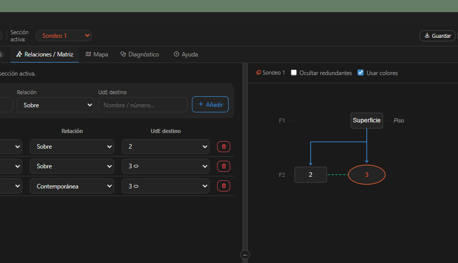

# Harris Matrix Manager

**A desktop editor for stratigraphic recording. Describe the relationships between stratigraphic units and the Harris Matrix is computed for you.**

*Version 0.5 · [Versión en español](#español)*



## What is it?

HM is an stratigraphic units composer that helps you build Harris Matrix. Instead of drawing the diagram by hand, you record each stratigraphic unit (SU) and its relationships (above, below, cuts, contemporary with). The program treats the sequence as a directed acyclic graph and builds the matrix automatically:

- **Phase assignment** by topological sort.
- **Contradiction detection** (stratigraphic cycles).
- **Redundant relationship detection** (Harris's Law of Superposition).
- Several excavation sections per project, each with its own matrix.
- Munsell colour picker, unit descriptions, composition and inclusions.
- Map of sections (Leaflet) and **GeoJSON export**, compatible with QGIS.
- Interface in English and Spanish. More languages can be added with a single JSON file in `renderer/lang/`.
- Includes Harris's Figure 12 as a worked example.

## Get the app

A ready-to-use Windows installer is available here:
**https://ishiba.gumroad.com/l/matrizdeharris**

Buying it supports the development of the project. Mac and Linux builds are planned.

## Run from source

Requires [Node.js](https://nodejs.org/).

```bash
git clone <this repository>
cd <folder>
npm install
npm start
```

To build an installer:

```bash
npm run build
```

The result is created in `dist/`.

## Feedback

This is an early version (0.5). Bug reports and suggestions are very welcome.

## License

Released under the **GNU General Public License v3.0**. See [LICENSE](LICENSE).
Copyright © 2026 iRO.

---

## Español

**Editor de escritorio para el registro estratigráfico. Describes las relaciones entre unidades estratigráficas y la matriz de Harris se calcula sola.**

### ¿Qué es?

HM es un gestor de unidades estratigráficas que puede producir matrices de Harris. En lugar de dibujar el diagrama a mano, registras cada unidad estratigráfica (UE) y sus relaciones (sobre, bajo, corta, contemporánea con). El programa trata la secuencia como un grafo dirigido acíclico y construye la matriz automáticamente:

- **Asignación de fases** mediante ordenamiento topológico.
- **Detección de contradicciones** (ciclos estratigráficos).
- **Detección de relaciones redundantes** (Ley de Superposición de Harris).
- Varias secciones de excavación por proyecto, cada una con su propia matriz.
- Selector de color Munsell, descripción, composición e inclusiones de cada unidad.
- Mapa de secciones (Leaflet) y **exportación a GeoJSON**, compatible con QGIS.
- Interfaz en español e inglés. Se pueden añadir más idiomas con un solo archivo JSON en `renderer/lang/`.
- Incluye la Figura 12 de Harris como ejemplo.

### Conseguir la aplicación

Hay un instalador listo para usar en Windows:
**https://ishiba.gumroad.com/l/matrizdeharris**

Comprarlo apoya el desarrollo del proyecto. Las versiones para Mac y Linux están planeadas.

### Ejecutar desde el código

Requiere [Node.js](https://nodejs.org/).

```bash
git clone <este repositorio>
cd <carpeta>
npm install
npm start
```

Para generar un instalador:

```bash
npm run build
```

El resultado se crea en `dist/`.

### Comentarios

Es una versión temprana (0.5). Los reportes de errores y sugerencias son muy bienvenidos.

### Licencia

Publicado bajo la **Licencia Pública General de GNU v3.0**. Consulta [LICENSE](LICENSE).
Copyright © 2026 iRO.
