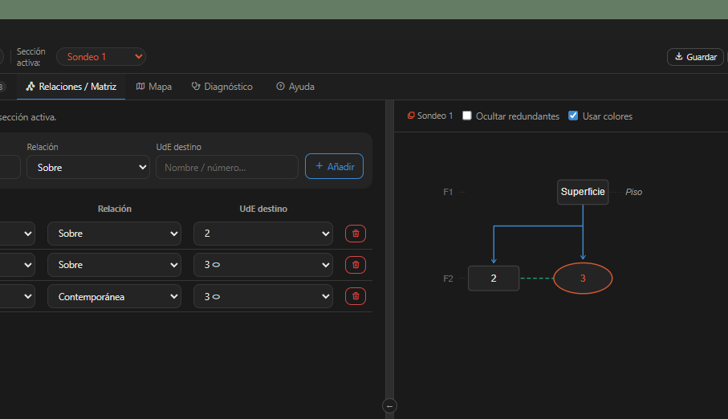

# Harris Matrix Manager

**A desktop editor for stratigraphic recording. Describe the relationships between stratigraphic units and the Harris Matrix is computed for you.**

*Version 0.6.2 · [Versión en español](#español)*



## What is it?

HM is an stratigraphic units composer that helps you build Harris Matrix. Instead of drawing the diagram by hand, you record each stratigraphic unit (SU) and its relationships (above, below, cuts, contemporary with). The program treats the sequence as a directed acyclic graph and builds the matrix automatically:

- **Phase assignment** by topological sort.
- **Contradiction detection** (stratigraphic cycles).
- **Redundant relationship detection** (Harris's Law of Superposition).
- Several excavation sections per project, each with its own matrix.
- Munsell colour picker, unit descriptions, composition and inclusions.
- Map of sections (Leaflet) and **GeoJSON export**, compatible with QGIS.
- Interface in English and Spanish. More languages can be added with a single JSON file in `renderer/lang/`.
- **Samples** (C14 BP, error, material, x/y/z) attached to each stratigraphic unit, with nominal CE/BCE and HE/BH dates (uncalibrated, approximate).
- **Automatic horizontal layout** of the matrix. To place a unit elsewhere, put it above/below another unit or between two, with a live preview.
- **GeoPackage export (.gpkg)** for QGIS: project, excavation units, stratigraphic units, samples and relationships.
- Includes Harris's Figure 12 and extra cases as a worked example.

## Get the app

Ready-to-use installers for Windows and macOS are available here:
**https://ishiba.gumroad.com/l/matrizdeharris**

Buying it supports the development of the project. A Linux build is planned.

**macOS note.** The Mac build is not signed with an Apple developer certificate (it costs 99 USD per year), so macOS blocks it the first time. After dragging the app to *Applications*, open Terminal and run:

```bash
sudo xattr -rd com.apple.quarantine "/Applications/Matriz de Harris.app"
```

Then type your password (it won't be displayed) and open the app.

## Run from source

Requires [Node.js](https://nodejs.org/).

```bash
git clone <this repository>
cd <folder>
npm install
npm start
```

To build an installer:

```bash
npm run build
```

The result is created in `dist/`.

## Feedback

This is an early version (0.6.2). Bug reports and suggestions are very welcome.

## License

Released under the **GNU General Public License v3.0**. See [LICENSE](LICENSE).
Copyright © 2026 iRO.

---

## Español

**Editor de escritorio para el registro estratigráfico. Describes las relaciones entre unidades estratigráficas y la matriz de Harris se calcula sola.**

### ¿Qué es?

HM es un gestor de unidades estratigráficas que puede producir matrices de Harris. En lugar de dibujar el diagrama a mano, registras cada unidad estratigráfica (UE) y sus relaciones (sobre, bajo, corta, contemporánea con). El programa trata la secuencia como un grafo dirigido acíclico y construye la matriz automáticamente:

- **Asignación de fases** mediante ordenamiento topológico.
- **Detección de contradicciones** (ciclos estratigráficos).
- **Detección de relaciones redundantes** (Ley de Superposición de Harris).
- Varias secciones de excavación por proyecto, cada una con su propia matriz.
- Selector de color Munsell, descripción, composición e inclusiones de cada unidad.
- Mapa de secciones (Leaflet) y **exportación a GeoJSON**, compatible con QGIS.
- Interfaz en español e inglés. Se pueden añadir más idiomas con un solo archivo JSON en `renderer/lang/`.
- **Muestras** (C14 BP, error, material, x/y/z) vinculadas a cada unidad estratigráfica, con fechas nominales CE/BCE y HE/BH (sin calibrar, aproximadas).
- **Posición horizontal automática** en la matriz. Para colocar una unidad en otro lugar, ponla sobre/bajo otra unidad o entre dos, con vista previa en vivo.
- **Exportación a GeoPackage (.gpkg)** para QGIS: proyecto, unidades de excavación, unidades estratigráficas, muestras y relaciones.
- Incluye la Figura 12 de Harris y casos adicionales como ejemplo.

### Conseguir la aplicación

Hay instaladores listos para usar en Windows y macOS:
**https://ishiba.gumroad.com/l/matrizdeharris**

Comprarlo apoya el desarrollo del proyecto. La versión para Linux está planeada.

**Nota para macOS.** La versión para Mac no está firmada con un certificado de desarrollador de Apple (cuesta 99 USD al año), por lo que macOS la bloquea la primera vez. Después de arrastrar la aplicación a *Aplicaciones*, abre la Terminal y ejecuta:

```bash
sudo xattr -rd com.apple.quarantine "/Applications/Matriz de Harris.app"
```

Escribe tu contraseña (no se mostrará) y abre la aplicación.

### Ejecutar desde el código

Requiere [Node.js](https://nodejs.org/).

```bash
git clone <este repositorio>
cd <carpeta>
npm install
npm start
```

Para generar un instalador:

```bash
npm run build
```

El resultado se crea en `dist/`.

### Comentarios

Es una versión temprana (0.6.2). Los reportes de errores y sugerencias son muy bienvenidos.

### Licencia

Publicado bajo la **Licencia Pública General de GNU v3.0**. Consulta [LICENSE](LICENSE).
Copyright © 2026 iRO.
